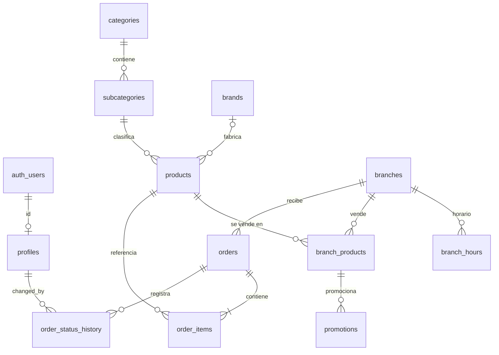

# Base de datos — Abarrotes Alex

PostgreSQL en Supabase. El esquema se define solo con migraciones SQL en
`supabase/migrations/`; los datos de desarrollo están en `supabase/seed.sql`.

| Migración                              | Contenido                                                     |
| -------------------------------------- | ------------------------------------------------------------- |
| `20261103000100_initial_schema.sql`    | Tipos, tablas, constraints, índices, folios, triggers         |
| `20261103000200_rls_policies.sql`      | Row Level Security, políticas de lectura pública y privilegios |
| `20261103000300_explicit_role_optional_brand.sql` | `profiles.role` sin default; `products.brand_id` opcional |
| `20261103000400_create_order.sql` | `orders.client_request_id`, esquema `private` y función `public.create_order` ([orders.md](orders.md)) |
| `20261103000500_admin_auth.sql` | `private.is_admin()`, políticas administrativas, privilegios y trigger de historial ([auth.md](auth.md)) |
| `20261103000600_search_unaccent.sql` | Extensión `unaccent`, `private.search_normalize()` y columna generada `products.search_name` (búsqueda sin acentos, [catalog.md](catalog.md)) |
| `20261103000700_admin_dashboard.sql` | `public.admin_dashboard()` (métricas del panel, `SECURITY INVOKER`, solo admin; [admin.md](admin.md)) |
| `20261103000800_admin_save_product.sql` | `public.admin_save_product()`: alta/edición atómica de `products` + `branch_products` (`SECURITY INVOKER`, solo admin; [admin.md](admin.md)) |
| `20261103000900_product_images_storage.sql` | Bucket público `product-images` (solo WebP, 2 MB) y políticas de escritura solo admin en `storage.objects` ([storage.md](storage.md)) |
| `20261103001000_promotions_integrity.sql` | Extensión `btree_gist`, exclusion constraint `promotions_no_overlap` y trigger `private.validate_promotion` (precio < normal, producto fijo) ([promotions.md](promotions.md)) |
| `20261103001100_order_status_transitions.sql` | Máquina de estados de pedidos: `private.order_status_transition_allowed`, trigger `validate_status_transition` y `public.update_order_status` (concurrencia con estado esperado) ([orders.md](orders.md)) |
| `20261103001200_order_search.sql` | `private.order_search_normalize` y columna generada `orders.customer_name_search` (búsqueda de pedidos sin acentos, conservando la ñ; [orders.md](orders.md)) |

```bash
npx supabase start        # requiere Docker
npx supabase db reset     # aplica migraciones desde cero + seed.sql (SOLO local)
```

### Proyecto remoto

El repositorio está vinculado con `supabase link` (el ref vive en
`supabase/.temp/`, ignorado por git). Flujo para desplegar cambios:

```bash
npx supabase migration list --remote          # comparar local vs remoto
npx supabase db push --remote --dry-run       # revisar qué se aplicará
npx supabase db push --remote                 # aplicar migraciones pendientes
```

- **Nunca** usar `db reset` contra el remoto.
- El seed de desarrollo se cargó una vez con `db push --remote --include-seed`.
  El CLI registra los seeds aplicados en `supabase_migrations.seed_files` y no
  los vuelve a ejecutar; `seed.sql` no es idempotente.
- Para comprobar la conexión de la app: `npm run check:supabase` (consulta las
  sucursales activas con la llave pública; no imprime URL ni llaves).

## Clientes de Supabase en la aplicación

Hay dos clientes de servidor con responsabilidades distintas. **No se mezclan.**

| Cliente | Archivo | Credencial | Cookies / sesión | Rol en la base | Uso |
| --- | --- | --- | --- | --- | --- |
| **Público** | `src/lib/supabase/public.ts` → `getPublicSupabase()` | Llave publishable | No lee cookies ni carga sesión | Siempre `anon` (RLS pública) | Catálogo, sucursales, horarios, promociones (`src/lib/catalog/*`), `POST /api/carrito` y la RPC `create_order` (`POST /api/pedidos`) |
| **SSR autenticado** | `src/lib/supabase/server.ts` → `createClient()` | Llave publishable | Lee y escribe las cookies de sesión (`@supabase/ssr`) | `authenticated` con el JWT del usuario | Auth (login/logout), `/admin`, `getAdminContext()` y cualquier dato que dependa de la sesión |

Reglas:

- **Datos públicos → cliente público.** No depende de la request: no fuerza
  render dinámico por cookies, no hace que Supabase Auth cargue una sesión (que
  compararía su expiración con `Date.now()` durante el prerender) y comparte una
  sola instancia entre requests. Sus consultas quedan listas para `"use cache"` en
  el futuro, porque nunca mezclan datos de un usuario.
- **Datos de sesión → cliente SSR**, siempre después de `await connection()`
  (ver `getAdminContext()` en [auth.md](auth.md)).
- Ninguno usa `service_role` ni secretos. Aunque un admin tenga sesión abierta,
  la tienda pública consulta como `anon`.

## Entidades

| Tabla                  | Propósito                                                                |
| ---------------------- | ------------------------------------------------------------------------ |
| `profiles`             | Usuario administrativo (1 a 1 con `auth.users`). Rol `admin` / `employee` |
| `branches`             | Sucursales. Se desactivan con `is_active`, no se borran                  |
| `branch_hours`         | Horario por sucursal y día (máx. un registro por día)                    |
| `categories`           | Categorías del catálogo                                                  |
| `subcategories`        | Subcategorías; cada una pertenece a una categoría                        |
| `brands`               | Marcas                                                                   |
| `products`             | Catálogo global (sin precio, sin categoría directa; marca opcional)      |
| `branch_products`      | Precio y disponibilidad de un producto en una sucursal                   |
| `promotions`           | Precio promocional de un `branch_product`, con vigencia opcional         |
| `orders`               | Pedido de un cliente a una sucursal                                      |
| `order_items`          | Partidas del pedido (snapshot histórico)                                 |
| `order_status_history` | Bitácora de cambios de estado del pedido                                 |



## Decisiones importantes

- **IDs**: `uuid` con `gen_random_uuid()` (nativo en PostgreSQL ≥ 13). `profiles.id` = `auth.users.id`.
- **Enums de PostgreSQL** para valores cerrados: `user_role`, `sale_type`
  (`unit`, `weight`), `product_unit` (`ml`, `L`, `g`, `kg`, `pieza`),
  `delivery_type`, `payment_method` (solo `cash` por ahora), `order_status`.
  Se amplían con `ALTER TYPE … ADD VALUE` en una migración (p. ej. `transfer`,
  `card`, `online`). Además, los tipos generados de Supabase los exponen como uniones TypeScript.
- **Rol explícito**: `profiles.role` es `NOT NULL` y **no tiene default**. Todo
  profile debe crearse indicando su rol (`admin` o `employee`); así ningún alta
  recibe privilegios por omisión.
- **Categoría derivada**: `products` no tiene `category_id`; se obtiene con
  `products → subcategories → categories`. Evita inconsistencias.
- **Marca opcional**: `products.brand_id` admite `NULL` para productos locales,
  a granel o genéricos. No existe una marca ficticia "Sin marca". La FK a
  `brands` se mantiene y solo se valida cuando hay valor. Las consultas que
  incluyan la marca deben usar `LEFT JOIN` (en PostgREST, el embed
  `brands(...)` sin `!inner`) para no excluir productos sin marca.
- **Slugs**: formato `^[a-z0-9]+(-[a-z0-9]+)*$`. Únicos globalmente en
  `categories`, `brands` y `products`. En `subcategories` el slug es **único
  dentro de su categoría** (`unique (category_id, slug)`): las URLs serán
  anidadas (`/categoria/bebidas/refrescos`) y así dos categorías pueden tener,
  p. ej., una subcategoría `otros`.
- **Presentación**: `presentation numeric(10,3)` (cantidad: 600, 1.5, 250, 12)
  + `unit product_unit`. Ambos o ninguno. Para productos `weight` se usa
  presentación `1 kg` y el precio de sucursal se interpreta por kilo.
- **Dinero**: `numeric(10,2)` (exacto, nunca `float`).
- **`image_path`**: solo el object path dentro del bucket (p. ej.
  `products/<uuid>.webp`). Un `CHECK` rechaza URLs completas y paths con `/` inicial.
- **WhatsApp**: `branches.whatsapp_number` guarda solo dígitos en formato
  internacional sin `+` (p. ej. `52` + 10 dígitos), listo para
  `https://wa.me/<numero>`.
- **`branch_hours.day_of_week`**: `0 = domingo … 6 = sábado` (igual que
  `EXTRACT(DOW)` y `Date#getDay()`). Un día abierto requiere apertura y cierre
  con `closing_time > opening_time` (no se modelan horarios que crucen medianoche).
- **Timestamps**: `timestamptz`, `created_at default now()`, `updated_at`
  mantenido por la función `public.set_updated_at()` + un trigger por tabla.
  `branch_hours`, `order_items` y `order_status_history` no tienen `updated_at`.
- **`orders.address_references`**: el prompt pedía `references`, pero es palabra
  reservada de SQL (obligaría a entrecomillarla siempre).

### Constraints de pedidos

- `total = subtotal + coalesce(shipping_cost, 0)`: `shipping_cost` NULL significa
  "envío por confirmar" y `total` es el total conocido por el sistema.
- `delivery_type = 'delivery'` exige `address`; en `pickup` puede ser NULL.
- `cash_amount` (con cuánto paga el cliente) es opcional y solo válido con `payment_method = 'cash'`.
  No se exige `cash_amount >= total` porque el total puede cambiar al confirmar el envío.
- `customer_phone` solo dígitos (10–15); límites de longitud en textos libres.
- `order_items.subtotal = round(unit_price * quantity, 2)`, `quantity > 0`
  (`numeric(10,3)` para permitir peso).
- No se valida en BD que la suma de partidas = `orders.subtotal`; lo garantizará
  la operación server-side de creación de pedidos.

## Estrategia multisucursal

El catálogo es **global** (categorías, subcategorías, marcas, productos). Lo que
cambia por sucursal vive en `branch_products` (precio, disponibilidad, uno por
`(branch_id, product_id)`) y en `promotions` (cuelgan de `branch_products`).
Cada pedido pertenece a una sola sucursal (`orders.branch_id`). Agregar una
sucursal no requiere cambios de esquema.

## Snapshots en `order_items`

Cada partida copia `product_name`, `product_presentation` (texto, p. ej.
`"600 ml"`), `unit_price`, `quantity` y `subtotal` al crear el pedido.
`product_id` se conserva como referencia, pero un pedido histórico **nunca** se
reconstruye con precios o nombres actuales. Verificado: cambiar precio, nombre
o desactivar el producto no altera la partida.

## Folios

`orders.folio` tiene `default public.next_order_folio()`, que usa la sequence
`public.order_folio_seq`: `ALEX-000001`, `ALEX-000002`, …

- `nextval` es atómico: dos pedidos concurrentes nunca reciben el mismo número
  (sin `COUNT(*) + 1`, sin locks). Además `folio` es `UNIQUE`.
- Puede haber **huecos** si una transacción hace rollback; es normal en sequences.
- Al pasar de 999999 crece a 7 dígitos (`ALEX-1000000`) en vez de truncarse.
- El `id` UUID sigue siendo el identificador técnico.
- `anon`/`authenticated` no pueden ejecutar `next_order_folio()` ni usar la
  sequence (evita "quemar" folios por RPC).

## Comportamiento ON DELETE

La regla general es **desactivar** (`is_active = false`), no borrar.

| FK                                          | Acción     | Motivo                                                        |
| ------------------------------------------- | ---------- | ------------------------------------------------------------- |
| `profiles.id → auth.users`                  | CASCADE    | El profile no existe sin su usuario                           |
| `subcategories.category_id`                 | RESTRICT   | No borrar categorías con subcategorías                        |
| `products.subcategory_id`, `products.brand_id` | RESTRICT | No dejar productos huérfanos (`brand_id` puede ser NULL)     |
| `branch_hours.branch_id`                    | CASCADE    | Configuración propia de la sucursal                           |
| `branch_products.branch_id` / `product_id`  | CASCADE    | Precio por sucursal; solo aplica si no hay pedidos que lo impidan |
| `promotions.branch_product_id`              | CASCADE    | La promoción no existe sin su producto de sucursal            |
| `orders.branch_id`                          | RESTRICT   | Una sucursal con pedidos no se puede borrar                   |
| `order_items.order_id`                      | CASCADE    | Las partidas son parte del pedido                             |
| `order_items.product_id`                    | RESTRICT   | Un producto vendido no se puede borrar: se desactiva          |
| `order_status_history.order_id`             | CASCADE    | Parte del pedido                                              |
| `order_status_history.changed_by`           | SET NULL   | Se conserva el historial si se elimina el usuario             |

## Índices

Los `UNIQUE` ya indexan: slugs de `categories`/`brands`/`products`,
`orders.folio`, `subcategories(category_id, slug)`,
`branch_hours(branch_id, day_of_week)` y `branch_products(branch_id, product_id)`
(estos compuestos cubren también búsquedas por su primera columna).

| Índice                                          | Motivo                                              |
| ----------------------------------------------- | --------------------------------------------------- |
| `products(subcategory_id)`                      | Listado de productos por subcategoría               |
| `products(brand_id)`                            | Filtro por marca y FK RESTRICT                      |
| `branch_products(product_id)`                   | Producto en todas las sucursales; CASCADE           |
| `promotions(branch_product_id) where is_active` | Promociones vigentes (parcial, solo activas)        |
| `orders(branch_id, created_at desc)`            | Pedidos de una sucursal, recientes primero          |
| `orders(status, created_at desc)`               | Colas por estado en el panel                        |
| `order_items(order_id)`                         | Partidas de un pedido                               |
| `order_items(product_id)`                       | FK RESTRICT al borrar un producto                   |
| `order_status_history(order_id, created_at)`    | Historial cronológico de un pedido                  |

## RLS inicial

RLS está activo en **todas** las tablas. Sin política = acceso denegado.

Lectura pública (`anon` y `authenticated`), solo `SELECT`:

| Tabla             | Visible si…                                                         |
| ----------------- | ------------------------------------------------------------------- |
| `branches`        | `is_active`                                                         |
| `branch_hours`    | su sucursal es visible                                              |
| `categories`      | `is_active`                                                         |
| `subcategories`   | `is_active` y su categoría es visible                               |
| `brands`          | `is_active`                                                         |
| `products`        | `is_active` y su subcategoría es visible (la marca inactiva no lo oculta) |
| `branch_products` | sucursal y producto visibles (incluye `is_available = false` para mostrar "agotado") |
| `promotions`      | `is_active`, dentro de `starts_at`/`ends_at` y su `branch_product` visible |

Para el público (anon y usuarios sin rol admin) siguen inaccesibles `profiles`,
`orders`, `order_items` y `order_status_history`: solo el admin los lee (y cada
usuario su propio profile). No hay INSERT público de pedidos: se crean únicamente
con `public.create_order` (`SECURITY DEFINER`, recalcula precios en la base,
transaccional). Ver [orders.md](orders.md) y [auth.md](auth.md).

Privilegios adicionales (defensa en profundidad): se revocan a `anon`
INSERT/UPDATE/DELETE/TRUNCATE en las tablas de `public` (TRUNCATE no pasa por
RLS). **Las tablas nuevas deberán repetir esta revocación** en su migración,
porque Supabase otorga privilegios por defecto a `anon`.

`service_role` ignora RLS: solo en servidor, nunca en variables `NEXT_PUBLIC_*`.

## Storage

Implementado en la Fase 8C.2: bucket público `product-images` (lectura pública por URL,
escritura solo admin con `private.is_admin()`), paths versionados
`products/{productId}/{uuid}.webp` en `products.image_path`. Ver [storage.md](storage.md).

## Autorización administrativa

Implementada en la Fase 7: `private.is_admin()`, políticas para el admin, profiles
sin escritura vía API y registro automático de cambios de estado. Ver [auth.md](auth.md).

Pendiente:

- Decidir si `employee` se restringe a una sucursal (requeriría relacionar profiles con branches).
- ~~Validar transiciones de estado de pedidos~~: implementado en la Fase 8E ([orders.md](orders.md)).
- ~~Impedir promociones activas traslapadas y validar `promotional_price < price`~~:
  implementado en la Fase 8D ([promotions.md](promotions.md)).
